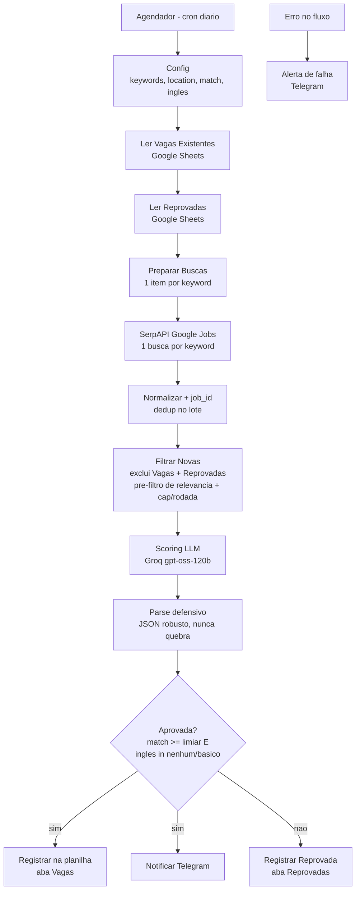

# 🎯 Monitor Inteligente de Vagas Tech

Automação **n8n self-hosted** que varre o mercado de trabalho brasileiro todos os dias, pontua cada
vaga (0-100) contra um **perfil real** usando IA, aplica uma **trava de idioma**, e entrega as
melhores oportunidades no **Telegram** - cada uma com carta de apresentação sob medida e faixa
salarial de mercado. O registro completo fica numa planilha do **Google Sheets**.

> Projeto de automação Low-Code + IA aplicada. Nasceu de uma necessidade real (busca ativa de
> recolocação) e virou peça de portfólio: tudo reprodutível, com um prompt pronto para você adaptar
> ao seu próprio perfil (ver [`PROMPT-REPLICAR.md`](PROMPT-REPLICAR.md)).

---

## Por que existe

Procurar vaga manualmente é repetitivo e ruidoso: os agregadores misturam cargos que não têm nada a
ver com o seu perfil, e você perde tempo lendo descrição por descrição. Este fluxo faz esse trabalho
sozinho, todo dia, e só te chama quando acha algo que **realmente** combina - com uma carta já escrita
para você revisar e enviar.

Honestidade técnica de arquitetura: o LinkedIn **não oferece API gratuita/legal** de busca de vagas, e
scraping direto fere o ToS (risco de banir a conta). Por isso as vagas são captadas de forma legítima
via **Google Jobs (SerpAPI)**, que indexa a parcela pública de vagas do LinkedIn, Gupy, Indeed,
Vagas.com e Catho num único endpoint.

---

## Arquitetura



**Stack:** n8n + PostgreSQL (Docker Compose) · SerpAPI (Google Jobs) · Groq (LLM `openai/gpt-oss-120b`)
· Telegram Bot · Google Sheets (service account). Proxy reverso + SSL pelo servidor web do VPS
(LiteSpeed/CyberPanel), sem abrir portas novas.

**Custo:** ~R$ 0/mês nos free tiers (SerpAPI ~250 buscas/mês, Groq free 8000 TPM, Telegram e Sheets
gratuitos), rodando num VPS que você já tenha.

---

## Como funciona (resumo)

1. **Agendador** dispara nos horários do cron.
2. **Config** define os cargos-alvo (keywords), localidade, limiar de match e a trava de idioma.
3. Lê o histórico das abas **Vagas** (aprovadas) e **Reprovadas** para **não reprocessar** nada.
4. Busca cada keyword no **Google Jobs** via SerpAPI, normaliza e gera um `job_id` estável (dedup).
5. **Filtrar Novas** remove o que já foi visto, aplica um pré-filtro de relevância e corta em N vagas
   por rodada (controle de custo/TPM do LLM).
6. O **Groq** pontua cada vaga (0-100), classifica o inglês exigido, o modelo de trabalho e o tipo de
   contratação, estima faixa salarial CLT/PJ e escreve a carta - **ancorada só no perfil, sem inventar**.
7. **Aprovada?** mantém apenas `match >= limiar` **E** inglês em `nenhum|basico`.
8. Aprovadas vão para a planilha + Telegram; reprovadas vão para a aba de auditoria (com o link da vaga).

---

## Deploy

Passo a passo completo em [`docs/DEPLOY.md`](docs/DEPLOY.md) (infra n8n no VPS) e
[`docs/ETAPA-2-WORKFLOW.md`](docs/ETAPA-2-WORKFLOW.md) (importar o workflow e vincular as credenciais).

Resumo:
```bash
cp .env.example .env     # preencha no servidor; chmod 600 .env
docker compose --env-file .env up -d
# n8n sobe em 127.0.0.1:5678; proxy + SSL no painel do servidor web
```
Depois importe o [`workflow.json`](workflow.json) no n8n e vincule as 4 credenciais pelo painel
(os segredos ficam no cofre do n8n - **nunca** no repositório).

---

## Estrutura da planilha (Google Sheets)

**Aba `Vagas`** (log completo das aprovadas): `Data_Captura · ID_Vaga · Titulo · Empresa · Localidade ·
Modelo · Contratacao · Match_% · Ingles_Exigido · Faixa_CLT · Faixa_PJ · Confianca_Salario · Fonte ·
Link_Candidatura · Motivos_Match · Red_Flags · Carta_Apresentacao · Status_Candidatura`

**Aba `Reprovadas`** (auditoria do filtro): `Data_Captura · Titulo · Empresa · Match_% · Ingles_Exigido
· Motivo_Descarte · Link_Candidatura`

> Os cabeçalhos casam por **nome exato** (sem acento/espaço) - crie-os iguais aos de cima.

---

## Decisões de arquitetura (o que aprendi construindo)

- **Groq em vez de Gemini:** o free tier do Gemini (~20 req/dia) é inviável para pontuar vaga por vaga.
  O Groq (`gpt-oss-120b`) tem limite alto; o gargalo é 8000 tokens/minuto, resolvido com **cap por
  rodada + mais rodadas no dia** (cada run no seu próprio minuto), em vez de uma rajada grande.
- **Termos em português vencem:** no Google Jobs BR, keywords de IA em português retornam vagas; os
  mesmos termos em inglês costumam voltar vazios. A lista de cargos é o lever de relevância da busca.
- **Anti-ruído:** deduplicar contra **Vagas e Reprovadas** evita gastar o orçamento de scoring
  reprocessando as mesmas vagas que já caíram - e impede que vagas fora do perfil monopolizem a fila.
- **Trava de idioma conservadora:** na dúvida entre básico e intermediário, classifica como
  intermediário (e descarta) - alinhado a quem só tem leitura básica de inglês.
- **Carta sem invenção:** o prompt proíbe citar qualquer experiência, cliente, número ou tecnologia
  que não esteja no perfil. Faixa salarial sempre com flag de confiança (nunca número inventado como fato).

---

## Como foi testado

- **Lógica pura** dos nós Code (normalização, `job_id`, parse defensivo do JSON, regra de aprovação,
  filtro de dedup) coberta por testes unitários.
- **Prova E2E na fonte:** as keywords foram validadas chamando a SerpAPI de verdade e inspecionando os
  títulos retornados, para garantir que a busca surfa vagas aderentes (não ruído).
- **Gate 3 ao vivo:** cenário feliz (vaga aderente -> Vagas + Telegram), inválido (inglês alto/gap ->
  Reprovadas) e ausência (JSON malformado -> não quebra o fluxo).

---

## Replicar para o seu perfil

Quer a mesma automação caçando as **suas** vagas? O arquivo [`PROMPT-REPLICAR.md`](PROMPT-REPLICAR.md)
tem um prompt pronto para colar no Claude Code (ou outro agente) e reproduzir toda a estrutura adaptada
ao seu CV, suas keywords e seus canais.

---

## Autor

**Junior** - Engenheiro de IA Aplicada e Automação de Processos.
[LinkedIn](https://www.linkedin.com/in/juniorogestor) · [GitHub](https://github.com/juniorogestor-wq)

## Licença

[MIT](LICENSE) - use, adapte e compartilhe. Se este projeto te ajudou, deixe uma ⭐.
